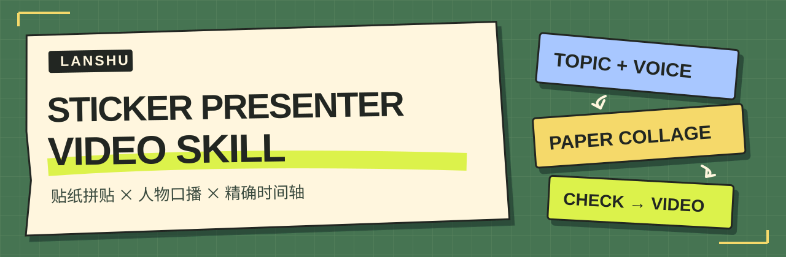

# 岚叔 · 贴纸拼贴人物口播



**给一个主题或一份口播稿，制作有纸片质感、人物贴纸和手写动效的视频。**

A reusable agent skill for sticker-collage presenter videos — from script to a checked final cut.

[](https://github.com/cclank/lanshu-sticker-presenter-video/actions/workflows/ci.yml)
[](https://github.com/cclank/lanshu-sticker-presenter-video/releases)
[](LICENSE)
[](https://github.com/cclank/lanshu-sticker-presenter-video/stargazers)
[](https://github.com/cclank/lanshu-sticker-presenter-video/forks)
[](SKILL.md)
[](https://www.python.org/)
[](https://ffmpeg.org/)
[](#默认规格)
[](#默认规格)
[](#画面与声音怎样配合)
[](https://x.com/LufzzLiz)

[安装](#安装) · [使用](#使用) · [效果预览](#效果预览) · [制作流程](#制作流程) · [版本下载](https://github.com/cclank/lanshu-sticker-presenter-video/releases)

## 效果预览


上图是已完成长口播案例中三个段落的**静音拼图预览**，展示人物抠像、纸片卡片与信息编排。完整声音需要在实际工程中试听验收。

| 案例 | 规格 | 结构 |
| --- | --- | --- |
| 桌面搭配参考 | 约 27 秒 · 1080×1920 · 30 fps | 主题钩子、要素海报、组合演示、人物收尾 |
| 岗位变化长口播 | 3 分 51.5 秒 · 1080×1920 · 30 fps | 21 个场景、60 条字幕，按讲解段落展开 |

仓库附带桌面案例的制作代码与计划示例。人物母片、克隆音色、音乐与字体文件由使用者自行准备。

## 适合做什么

- **主题讲解**：把一段知识、一个方法或产品卖点组织成有节奏的口播。
- **人物与信息同屏**：大幅人物贴纸搭配纸片海报、物品、手写标注和模拟界面。
- **沿用已有素材**：优先使用已授权的模特素材、人物参考与声音，记录素材来源。
- **准确呈现文字**：中文、数字和按钮由后期绘制，避免让生成模型承担精确排字。
- **完成到交付**：从脚本、时间轴推进到混音、媒体检查、成片和制作记录。

## 安装

将仓库克隆到 Codex 的用户 skill 目录：

```bash
git clone https://github.com/cclank/lanshu-sticker-presenter-video.git \
  "$HOME/.agents/skills/lanshu-sticker-presenter-video"
```

Codex 的用户目录与发现规则见[官方 skill 文档](https://learn.chatgpt.com/docs/build-skills)。使用自定义目录的宿主，请安装到它实际扫描的位置。同一宿主保留一份安装，避免同名 skill 重复出现。安装后通常会自动发现；未出现时重启 Codex。

也可从 [Releases](https://github.com/cclank/lanshu-sticker-presenter-video/releases) 下载 ZIP，解压后保留完整的 `lanshu-sticker-presenter-video/` 目录。

更新已克隆的安装：

```bash
git -C "$HOME/.agents/skills/lanshu-sticker-presenter-video" pull --ff-only
```

## 使用

在 Codex 对话中直接输入：

```text
用 $lanshu-sticker-presenter-video 做一条口播视频。
主题：如何打造一个专注工作的空间。
```

已有长口播稿时：

```text
用 $lanshu-sticker-presenter-video 制作这份口播稿。

时长：约 3—4 分钟，以实际语音长度为准，保留完整内容。
风格：贴纸拼贴、大幅人物、纸片卡片、手写标注。
素材：优先沿用我已授权素材库里的模特和音色。
声音：只保留一份人声，先试听，确认没有回音后合成。
先给出分镜、素材清单和具体费用，再启动需要付费的生成。

口播稿：
（粘贴正文）
```

可指定横屏、时长、字幕、人物、音色、是否允许新生成人物视频、预算和交付文件。用户的明确要求优先于默认值。

## 制作流程


### 画面与声音怎样配合

1. **先有可用口播，再定时间轴。** 按实际语音和源视频切镜点安排画面，长稿按段落扩展。
2. **人物保持足够大。** 奶黄色描边、纸片阴影、主题元素与手写字围绕人物展开，并避开脸部。
3. **把准确内容留给后期。** 标题、数字、按钮和操作提示使用确定的字体与布局绘制。
4. **只保留一份人声。** 画面轨静音，原声与替代配音选择其一，另加低音量音乐。结构检查后仍需完整试听。
5. **逐项验收。** 检查台词、口型、回音、绿边、遮脸、字体、转场、规格与完整解码。

### 默认规格

| 项目 | 默认值 |
| --- | --- |
| 语言 | 中文普通话 |
| 画布 | 1080×1920，竖屏 |
| 帧率 | 30 fps |
| 短片长度 | 约 27–35 秒；指定长稿按实际声音扩展 |
| 结构 | 钩子 → 要素海报 → 组合/操作演示 → 行动提示 |
| 交付 | MP4、关键帧拼图、计划、时间轴与 QA 记录 |

## 仓库内容

```text
lanshu-sticker-presenter-video/
├── SKILL.md                       # Agent 执行入口
├── agents/openai.yaml             # Codex 展示名与默认调用
├── references/                    # 风格、分镜、提示词与制作交接
├── assets/
│   ├── production-template.json   # 新主题计划模板
│   └── reference-project/         # 桌面搭配参考代码与示例转写
├── scripts/
│   ├── prepare_project.py         # 创建独立工程，防止覆盖旧工程
│   └── check_project.py           # 计划、媒体长度与人声轨结构检查
├── examples/                      # 已填写的桌面案例计划
├── tests/                         # 工作流与合成失败保护测试
└── docs/assets/                    # README 视觉与静音预览
```

### 本地辅助命令

在仓库目录运行：

```bash
python3 scripts/prepare_project.py ./outputs/desk-demo --topic '桌面搭配'

# 填完新工程的脚本、时长、场景等字段后检查
python3 scripts/check_project.py ./outputs/desk-demo/production.json

# 素材齐备后检查媒体与剪辑清单
python3 scripts/check_project.py ./outputs/desk-demo/production.json \
  --media --edl ./outputs/desk-demo/edit.json

# 无需素材即可验证仓库中的计划示例
python3 scripts/check_project.py examples/desk-styling.production.json
```

`prepare_project.py` 创建计划与工程骨架。新计划的留空字段需要 Agent 按主题补齐。

参考渲染器使用 OpenCV/Pillow，包含原案例的台词、图形、时间与字体路径。用于新主题前应改写这些内容，并准备所需素材；具体布局与入口见[参考工程说明](references/reference-project.md)。并行渲染脚本会逐个等待分片并验证帧数，全部成功后才替换成片，失败日志会保留。

本仓库提供制作流程、模板和参考实现。实际出片还需要 Agent、可用的素材/模型服务，以及逐项验收。

## 依赖与费用

| 能力 | 依赖 |
| --- | --- |
| 创建计划、结构检查 | Python 3.10+ 标准库 |
| 媒体检查与合成 | FFmpeg / ffprobe |
| 参考画面渲染 | NumPy、OpenCV、Pillow，以及自行准备的中文字体 |
| 图片、口播、口型与云端制作 | 默认适配 Renoise MCP；也可由 Agent 接入其他已授权工具链 |

skill 本身按 MIT 开源。模型调用、配音、口型与云端后期可能收费，按当前服务报价与当次授权执行；仓库不包含 API key、服务额度或人物/音色使用权。

素材必须来自你有权使用的来源。公开包移除了私人素材编号、云端工程路径和临时下载链接。音色能否精确复用，需要查看当前服务与素材库实际支持的能力。

## 开发与贡献

```bash
python3 -m unittest discover -s tests -v
python3 -m compileall -q scripts assets/reference-project/scripts
bash -n assets/reference-project/scripts/render_all.sh
```

媒体集成测试使用 FFmpeg 生成的微型测试片段，不调用付费模型。没有 FFmpeg 的环境会跳过媒体测试。GitHub Actions 在 Python 3.10、3.12、3.13 上执行检查。

欢迎提交新的布局、对齐方法、错误处理和经过验证的工具适配。提交规范见 [CONTRIBUTING.md](CONTRIBUTING.md)。

## 许可与相关项目

代码、skill 文本和模板采用 [MIT License](LICENSE)。预览与外部素材范围见 [NOTICE.md](NOTICE.md)。本项目由 Lanshu 维护，与所列服务商无隶属关系。

- [Lanshu Infinite Stream Koubo](https://github.com/cclank/lanshu-infinite-stream-koubo) — 可复用素材库口播工作流
- [Lanshu HTML PPT Templates](https://github.com/cclank/lanshu-html-ppt-templates) — HTML 演示模板
- [关注岚叔的 X](https://x.com/LufzzLiz)
